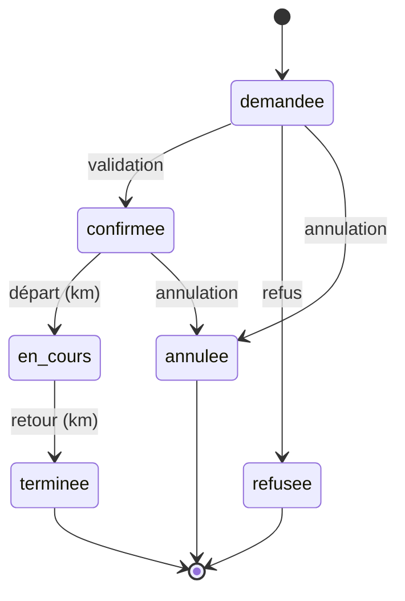

# Analyse — Gestion de flotte « Delvaux & Fils »

> Projet fictif servant de support aux exercices de développement assisté par IA. Entrée du workflow d'analyse
> (`/analyse-feature`) ; copie de `tmp/analyse-gestion-de-flotte.md` complétée par les **réponses du client** (§ 8).

## En bref

| Paramètre | Valeur |
| --- | --- |
| Client | Delvaux & Fils, PME belge de logistique, environ 200 personnes, 3 dépôts |
| Besoin | Application web de gestion de la flotte de véhicules de service |
| Utilisateurs | Conducteurs, gestionnaires de flotte, administrateur |
| Volume | Une soixantaine de véhicules, environ 150 conducteurs |
| Stack | Libre |

## 1. Contexte client

Delvaux & Fils possède une soixantaine de véhicules répartis sur trois dépôts (Charleroi, Namur, Liège) : voitures de service, camionnettes et quelques poids lourds. Aujourd'hui, les réservations se font sur un tableau blanc dans chaque dépôt, les pleins sont notés sur des tickets de caisse et les entretiens sont suivis de mémoire par le gestionnaire de flotte.

Conséquences constatées par la direction : véhicules réservés deux fois, contrôles techniques oubliés, aucune vision des coûts par véhicule, sinistres déclarés en retard à l'assurance.

La direction vous mandate pour livrer une application qui permette aux employés de réserver un véhicule, au gestionnaire de flotte de suivre l'entretien et les coûts, et à l'administrateur de gérer les comptes et les référentiels.

## 2. Rôles et périmètre fonctionnel

### 2.1 Rôles

| Rôle | Qui | Peut faire |
| --- | --- | --- |
| `CONDUCTEUR` | Tout employé titulaire d'un permis | Réserver un véhicule, consulter **ses** réservations, saisir ses pleins, déclarer un sinistre |
| `GESTIONNAIRE` | Gestionnaire de flotte (un par dépôt) | Gérer les véhicules de son dépôt, planifier et clôturer les entretiens, traiter les sinistres, consulter les coûts |
| `ADMIN` | Responsable logistique | Tout ce qui précède, sur tous les dépôts, plus les comptes, les référentiels et les statistiques |

### 2.2 Fonctionnalités attendues

**Réservations**

- Un conducteur réserve un véhicule pour une période (début et fin, à l'heure près) avec un motif.
- Les réservations doivent être validées avant le départ.
- Au départ, le conducteur relève le kilométrage ; au retour, il saisit le kilométrage d'arrivée et peut signaler une anomalie.
- Un planning affiche, pour chaque dépôt, l'occupation des véhicules sur la semaine, afin que chaque conducteur choisisse un véhicule libre.

**Parc et entretien**

- Fiche véhicule : immatriculation, type, dépôt, kilométrage, statut, documents (assurance, contrôle technique) avec date d'expiration.
- Plan d'entretien par type d'intervention (vidange, pneus, contrôle technique…) avec un intervalle en kilomètres et un intervalle en mois.
- Liste des entretiens à prévoir et des documents qui expirent dans les 30 jours.

**Carburant et sinistres**

- Saisie d'un plein : date, litres, montant, kilométrage.
- Déclaration de sinistre : date, description, gravité, photos facultatives. Le gestionnaire suit le dossier jusqu'à sa clôture.

**Pilotage (ADMIN)**

- Coût total par véhicule et par dépôt (carburant, entretien, sinistres) sur une période.
- Taux d'utilisation des véhicules, consommation moyenne aux 100 km.

## 3. Cycle de vie d'une réservation

Le conducteur crée la réservation au statut `demandee` et peut l'annuler tant qu'il n'est pas parti. `terminee`, `refusee` et `annulee` sont des statuts finaux.

## 4. Règles métier

Ces règles sont appliquées côté serveur, quelle que soit l'interface utilisée.

| Code | Règle |
| --- | --- |
| RM1 | Deux réservations confirmées ou en cours d'un même véhicule ne peuvent pas se chevaucher. |
| RM2 | Un conducteur ne peut réserver qu'un véhicule dont le type correspond à sa catégorie de permis. |
| RM3 | Un véhicule en entretien ou hors service ne peut pas être réservé. |
| RM4 | Le kilométrage d'un véhicule ne diminue jamais. Un retour de réservation ou un plein avec un kilométrage inférieur au kilométrage courant est refusé ; un kilométrage supérieur met à jour celui du véhicule. |
| RM5 | Un entretien est à prévoir quand l'intervalle en kilomètres ou l'intervalle en mois de son type est atteint. |
| RM6 | Un sinistre de gravité « grave » met le véhicule hors service. |
| RM7 | Un document dont la date d'expiration est dépassée rend le véhicule non réservable. |
| RM8 | Un changement de statut de réservation non prévu par le cycle de vie (§3) est refusé. |
| RM9 | Un conducteur ne voit et ne modifie que ses propres réservations, pleins et sinistres. Un gestionnaire ne gère que les véhicules de son dépôt. |
| RM10 | Les suppressions sont logiques : un élément supprimé est désactivé, n'apparaît plus dans l'application, mais reste en base. |

## 5. Données manipulées

Les entités ci-dessous décrivent le besoin, pas un schéma imposé : noms, types et découpage en tables restent à votre choix.

| Entité | Informations | Relations |
| --- | --- | --- |
| Utilisateur | Identifiant de connexion, e-mail, mot de passe, nom, prénom, catégorie de permis (B, C ou CE) | Rattaché à un dépôt ; possède un ou plusieurs rôles |
| Rôle | Nom (conducteur, gestionnaire, admin) | Plusieurs utilisateurs par rôle |
| Dépôt | Nom, adresse, ville | Un gestionnaire ; des véhicules et des utilisateurs |
| Type de véhicule | Nom, permis requis, nombre de places | Des véhicules |
| Véhicule | Immatriculation, numéro de châssis, marque, modèle, kilométrage, statut (disponible, en entretien, hors service), date d'achat | Un type, un dépôt ; des documents, réservations, pleins, entretiens, sinistres |
| Document de véhicule | Type (assurance, contrôle technique, carte grise), numéro, date d'expiration (aucune pour la carte grise) | Un véhicule |
| Réservation | Début et fin (date et heure), motif, statut, kilométrage au départ et au retour, remarque au retour | Un véhicule, un conducteur, un valideur |
| Plein | Date, litres, montant, kilométrage | Un véhicule, un conducteur |
| Type d'entretien | Nom, intervalle en kilomètres, intervalle en mois | Des entretiens |
| Entretien | Date prévue, date de réalisation, kilométrage, coût, garage | Un type, un véhicule |
| Sinistre | Date, description, gravité (mineur, moyen, grave), statut (déclaré, en traitement, clos), coût | Un véhicule, un conducteur, éventuellement une réservation ; des photos |
| Photo de sinistre | Nom du fichier, taille | Un sinistre |

## 6. Exigences techniques

- Authentification obligatoire ; mots de passe hachés avec un algorithme adapté.
- Contrôle des rôles et de l'appartenance (RM9) sur chaque action, côté serveur.
- Téléversement des photos : type et taille contrôlés, nom de fichier non devinable, téléchargement soumis au contrôle d'accès.
- Aucun secret dans le dépôt de code.
- Schéma de base de données versionné et rejouable.
- Tests automatisés couvrant au minimum les règles RM1 à RM10.

## 7. Livrables

- Dépôt Git, branche principale toujours fonctionnelle.
- `README` : installation, lancement, comptes de démonstration.
- Données de démonstration : un compte par rôle, 3 dépôts, quelques types de véhicule, une dizaine de véhicules, des types d'entretien.
- Application fonctionnelle et démonstration orale.

## 8. Réponses du client

Questions de cadrage posées le 16/11/2026 (plan `tmp/plan/delvaux.md`, partie 0.2). Ces réponses **complètent ou
précisent** les sections ci-dessus et priment sur elles en cas de doute.

| # | Question | Réponse du client | Impact (feature) |
|---|---|---|---|
| C1 | Qui valide une réservation ? | Le **gestionnaire du dépôt du véhicule**, ou un admin. Pas de validation automatique. | 009 |
| C1b | Un gestionnaire (ou admin) peut-il valider **sa propre** réservation ? | **Non** : la réservation doit être validée par **un autre** valideur (un admin, ou le gestionnaire d'un autre dépôt). | 009 |
| C2 | Réservation d'un véhicule d'un **autre dépôt** ? | **Oui**. Le planning reste présenté par dépôt. | 008, 011 |
| C3 | Hiérarchie des permis ? | **CE ⊇ C ⊇ B** : un titulaire CE conduit C et B, un titulaire C conduit B. | 008 (RM2) |
| C4 | Cumul de rôles ? | **Oui** (ex. un gestionnaire qui conduit est aussi `CONDUCTEUR`). | 001, 002 |
| C5 | Durée maximale, délai minimal de réservation ? | **Aucune limite**. Seule contrainte : pas de réservation dans le passé (début ≥ maintenant, fin > début). | 008 |
| C6 | Une anomalie au retour change-t-elle le statut du véhicule ? | **Non** : l'anomalie est enregistrée et **notifiée au gestionnaire**, qui décide du statut. | 010 |
| C7 | Quand un véhicule passe-t-il « en entretien » ? | Sur **action explicite du gestionnaire** : planifier ne bloque rien ; « démarrer » → en entretien, « clôturer » → disponible. | 013 |
| C8 | Réservations futures d'un véhicule mis hors service / en entretien ? | **Conservées** ; le gestionnaire est **alerté** et les traite (annulation ou réaffectation). | 006, 013, 015 |
| C9 | Définition du taux d'utilisation ? | Heures d'**utilisation effective** (départ → retour) / **heures ouvrées** de la période (lundi–vendredi, 8 h–18 h, Europe/Brussels). | 018 |
| C10 | Photos de sinistre : contraintes ? | **JPEG et PNG** uniquement (HEIC converti côté front), **10 photos** max par sinistre, **10 Mo** max chacune, métadonnées **EXIF supprimées**, conservation = celle du dossier de sinistre. | 016 |
| C11 | Le NISS fait-il partie du projet ? | **Oui, sur l'utilisateur** : NISS du conducteur, stocké **chiffré** (`CryptoService`), unique (index aveugle), jamais exposé en clair hors besoin autorisé. Finalité RGPD à documenter dans l'analyse 002. | 002 |
| C12 | Fuseau horaire ? | Hypothèse retenue (non contestée) : **Europe/Brussels** uniquement ; stockage **UTC**, conversion à l'affichage. | socle 1.4, 008, 011, 018 |

### Ajouts au modèle de données (§ 5)

- **Utilisateur** : + **NISS** (donnée sensible, chiffrée — C11).
- **Réservation** : le **valideur** est distinct du conducteur (C1b) ; + indicateur d'**anomalie** au retour (C6).
